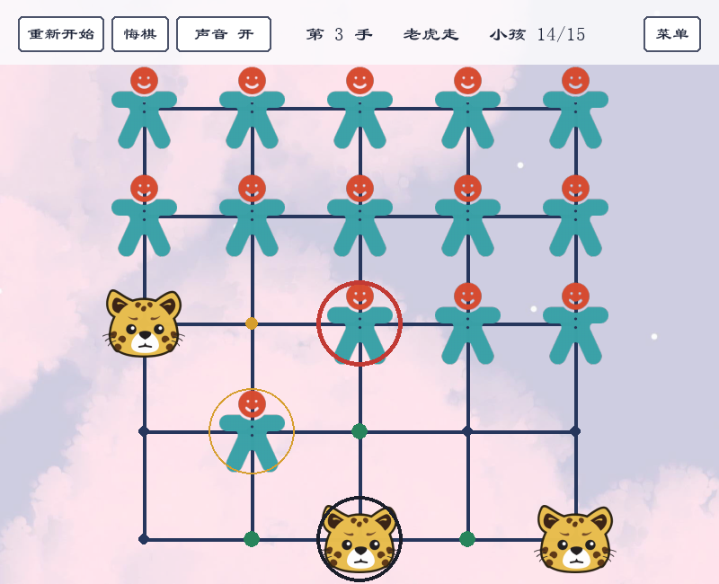

# 老虎吃小孩

5×5 本地棋：3 只老虎对 15 个小孩。可以双人同屏，也可以和电脑下。



## 规则

- 小孩 15 个，占上方三排；老虎 3 只，占最下行第 1、3、5 列；老虎先走。
- 双方每次走一格：上下左右到相邻空位。
- 老虎可以隔一个空格，吃掉同方向两格外的小孩；落点就是被吃的那格。
- 老虎吃光小孩，或小孩无路可走，老虎胜；老虎无路可走，小孩胜。
- 只判“轮到走的一方”：走完换边，轮到谁、谁没路，谁输。
- 同一局面和行棋方出现 3 次，或连续 100 个半步没有吃子，和棋。

## 运行

Python 3.10–3.14。

```powershell
python -m pip install -r requirements.txt
python main.py
```

依赖是 `pygame-ce`，`import pygame` 兼容的社区版，3.10–3.14 都有 wheel。

## 操作

- 启动菜单：双人同屏 / 我执老虎 / 我执小孩，电脑难度 简单/普通/困难；点击模式开始。
- 鼠标左键选子，再点落点；再点已选棋子或空白处取消选择。
- 顶栏：重新开始 / 悔棋 / 声音 / 菜单。
- 快捷键：`R` 重开，`U` 悔棋，`M` 静音，`Esc` 退出（菜单打开时返回游戏）。
- 绿色圆点是合法落点，红色圈是吃子，深色圈是当前选中的棋子，黄色是上一步。

## 开发

```powershell
python -m pip install -r requirements.txt ruff mypy
python -m ruff check .
python -m ruff format --check .
python -m mypy
python -m unittest discover -s tests -v
```

CI 在 Ubuntu 上跑 lint/type 和 Python 3.10/3.14 的测试。

## 结构

- `rules.py`：棋盘、着法、胜负、历史/悔棋。
- `ai.py`：alpha-beta 搜索和三档难度。
- `app.py`：Pygame 界面、菜单、输入。
- `config.py`：资源路径、布局、颜色。
- `main.py`：入口。
- `tools/make_font.py`：从系统字体生成界面用字子集；改了界面文字后重跑一次。
